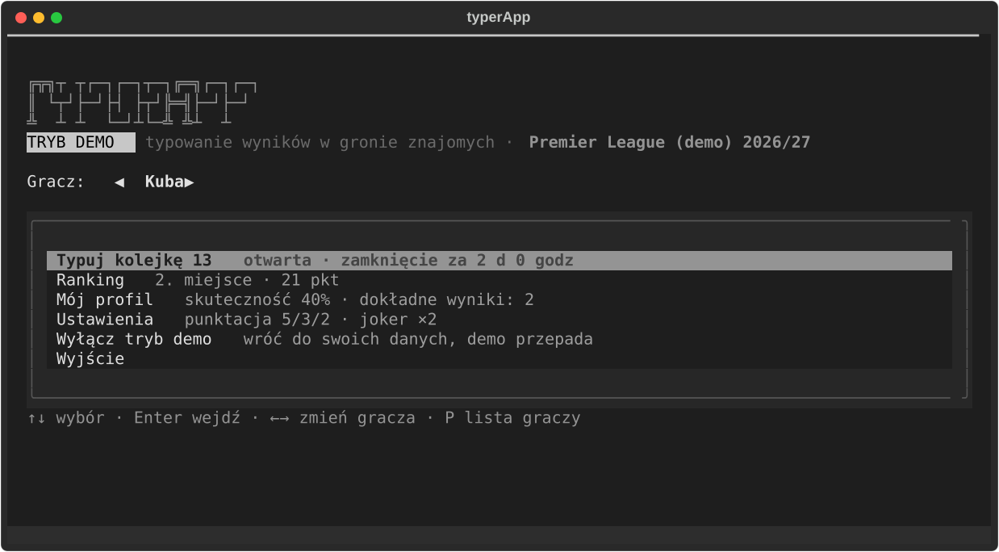
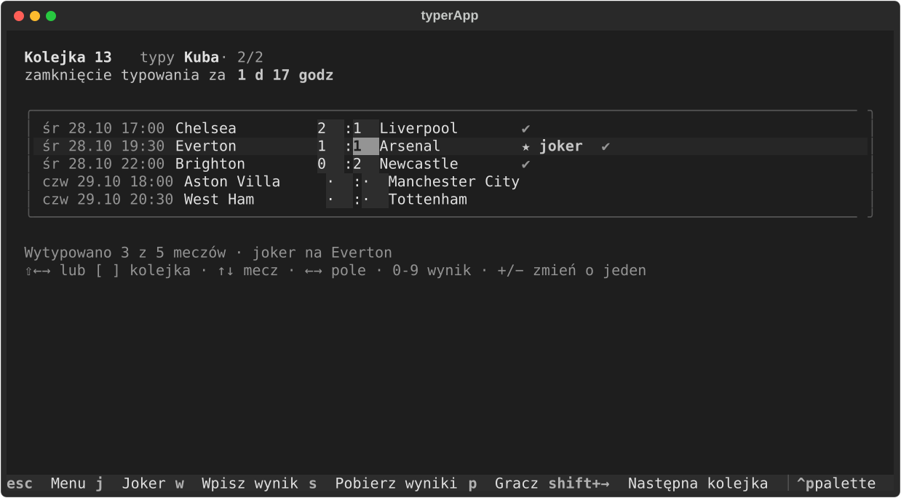
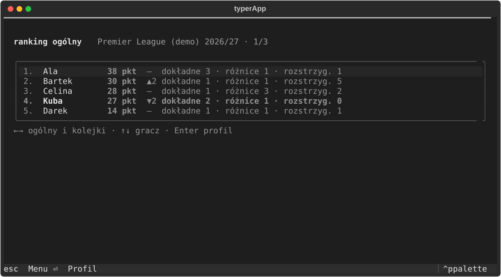
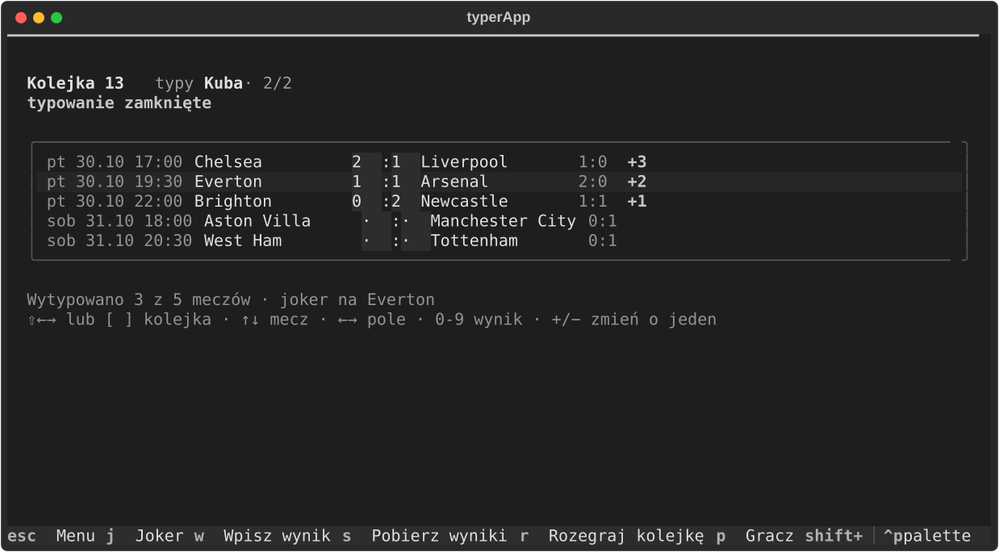
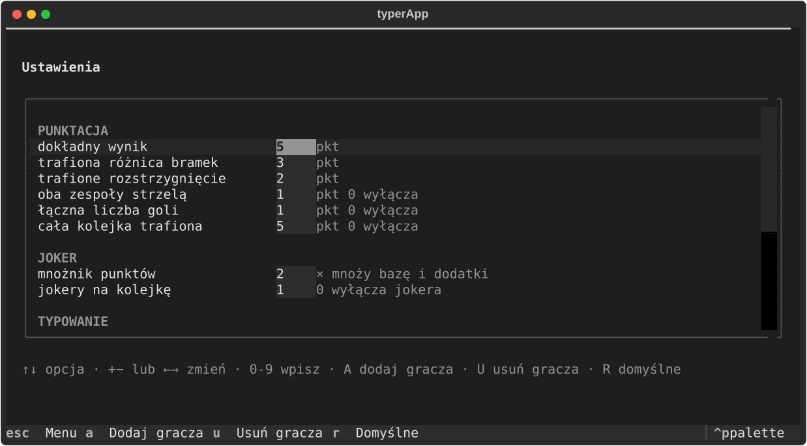

# typerApp

A football score prediction game for a group of friends, played at one keyboard. Players
predict the results of upcoming league matches; the app fetches the real ones from the
[football-data.org](https://www.football-data.org/) API (or takes them typed in by hand),
awards points and keeps a leaderboard.



The project is built in stages for a Human–Computer Interaction university course:

| Stage | Description | Location | Tag |
|-------|-------------|----------|-----|
| 1 | Terminal UI (Textual) | `src/typerapp_tui` | `v1.0-tekstowy` |
| 2 | Desktop GUI (PySide6) | `src/typerapp_gui` | `v2.0-graficzny` |
| 3 | Specification and Figma prototype | `docs/` | – |

The shared core (domain model, scoring, ranking, storage, controller) lives in
`src/typerapp_core` and does not depend on any UI library, so the desktop version is a new
presentation layer rather than a rewrite. A test guards that boundary.

## Predicting



There is no edit mode: the arrows pick the match and the field, digits fill the score, and a
match takes two keystrokes because the first digit jumps to the away field. Predictions save
themselves. `J` places the joker, which doubles everything that match pays out, and it can be
moved around until the matchday closes — five minutes before its first kickoff by default.

## Scoring

| | Points |
|---|---|
| Exact score | 5 |
| Right goal difference | 3 |
| Right winner or a draw | 2 |
| Both teams scored, guessed correctly | +1 |
| Right number of goals in the match | +1 |
| Every result of the matchday guessed | +5 |
| Joker | the match total ×2 |

Every number is editable in the settings, and setting one to zero switches that reward off.
The leaderboard is always recomputed, so changing the rules immediately reshuffles it.



## Running

```bash
uv sync
uv run python -m typerapp_tui
```

Copy `.env.example` to `.env` and paste a football-data.org key into it. The free plan covers
the five big leagues (Premier League, Serie A, La Liga, Bundesliga, Ligue 1) and the
Champions League, which are the competitions the app offers. It allows about ten requests a
minute, so the app fetches three
matchdays at a time and caches everything in SQLite.

- `S` fetches the previous, the current and the next matchday; the app also does it on
  start-up when the cache is older than five minutes.
- `W` types a result in by hand, which is how the app works with no key and no network.
- `L` picks the league, `D` clears the data of the one that is active.

### Demo mode

```bash
uv run python -m typerapp_tui --demo
```

The same mode is the "Tryb demo" entry in the menu. It builds a fresh game in memory every
time it is switched on: five players, last matchday played and predicted by all of them, the
next one open. Press `R` on the matchday screen to play it out match by match and watch the
points land and the leaderboard move. Nothing is written to disk, so switching it off brings
back the real data untouched, and the demo can never go stale.



Without a key the app still runs on cached data and hand-typed results, and the demo mode
needs no network at all.



## Development

```bash
uv run pytest
uv run ruff check .
uv run ruff format .
```

The tests cover the core (scoring, ranking, storage, synchronisation) and drive the interface
itself through Textual's `Pilot`, pressing real keys against a real app on an in-memory
database. The API client is tested against a recorded answer, so nothing touches the network.
